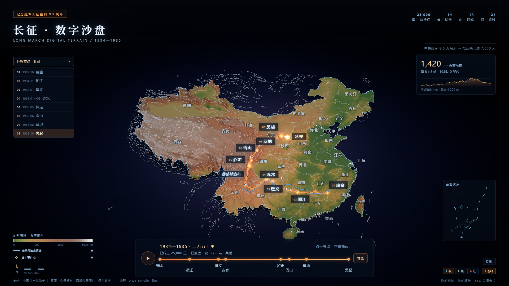
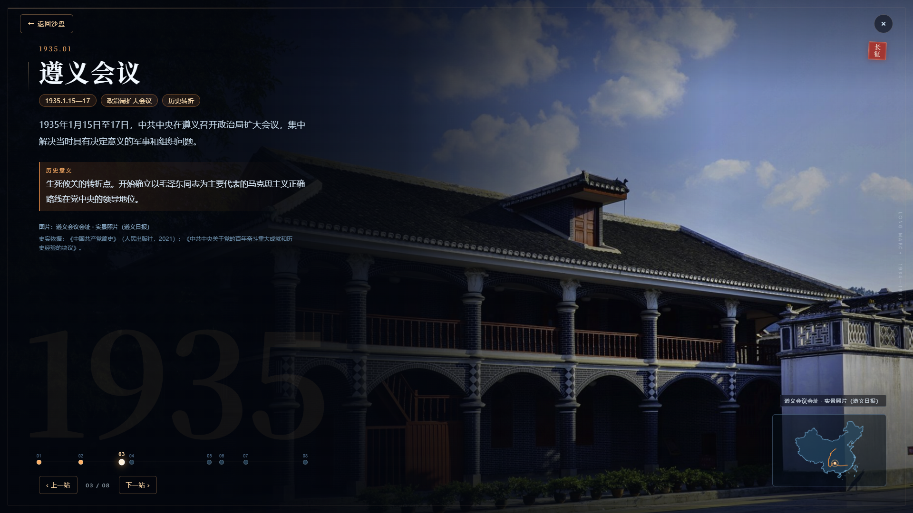
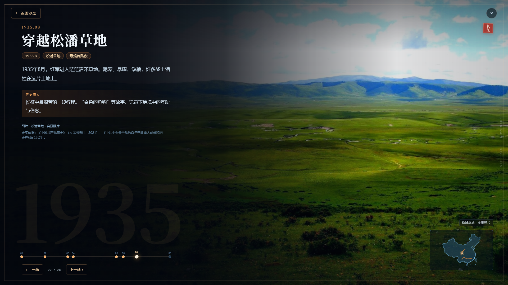
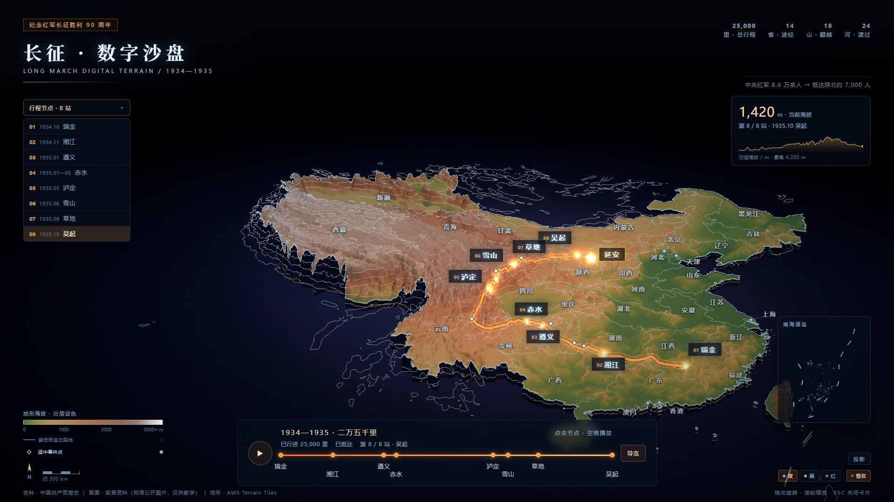
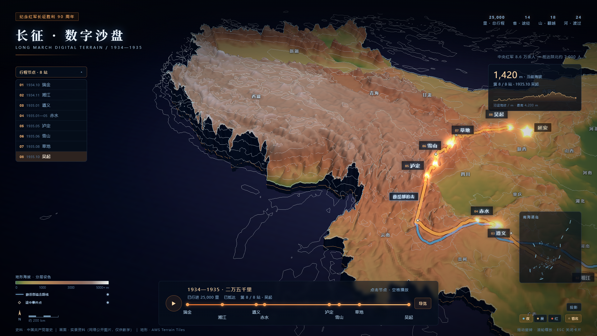
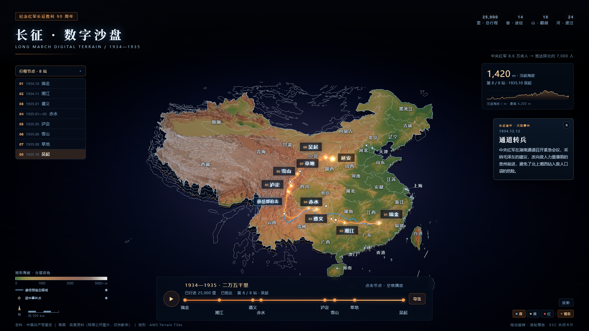

# 长征 · 数字沙盘

**Long March Digital Sandbox** — 1934–1935 年中央红军长征的 3D 地形沙盘。用 Three.js 把阿尔伯斯投影、真实高程、21 个途经点、8 个史实站点、34 个省名和一条国民党军追击路线放进一个可以旋转、缩放、播放的网页。

[](LICENSE)
[](https://threejs.org/)
[](index.html)

**在线演示**：<https://chongyep.github.io/3D-map-modeling/> · **单文件下载**：[`index.html`](index.html)



## 这是什么

这是一个面向课堂展示/自学浏览的历史地理可视化项目：

- **真实 3D 地形**：AWS Terrain Tiles 高程 → 阿尔伯斯等积投影 → 480×414 网格位移，带分层设色、等高线与陆地裁剪。
- **8 个主站**：瑞金、湘江、遵义、四渡赤水·巧渡金沙江、泸定、雪山、草地、吴起。点击站点先俯冲，再进入全屏实景信息页。
- **6 个途中事件点**：通道转兵、黎平会议、强渡乌江、巧渡金沙江、懋功会师、腊子口。小菱形挂在路线上，悬停看名称，点击出小卡，不占时间轴。
- **34 个省名**：按辖区手工落点，屏幕空间自动避让，缩放/旋转时保持可读。
- **薛岳部追击路线**：按有明确记载的主要节点复原的蓝色管线，和红军主线同精度；不是逐日行军轨迹。
- **叙事层**：时间轴播放、自动导览、三套主题（夜/晨/红）、投影模式、海拔剖面、当前海拔、南海诸岛小图。
- **单文件离线**：构建产物是一个约 7.3 MB 的 HTML，图片、地形、GeoJSON 全部内联，双击即可打开，不需要服务器。

> 历史说明：路线是关键节点连线，不是逐日 GPS 轨迹；薛岳部最远到西昌，没有一支国民党军从江西一路追到陕北。详见 [使用说明](docs/使用说明.md) 与 [开发文档](docs/DEVELOPMENT.md)。

## 快速开始

### 只看成品

直接下载/克隆仓库，双击根目录的 [`index.html`](index.html) 即可。也可以用任意静态服务器：

```bash
git clone https://github.com/ChongYep/3D-map-modeling.git
cd 3D-map-modeling
node scripts/serve-demo.mjs
# http://127.0.0.1:5201/
```

### 从源码构建

需要 Node.js 20.19+ 或 22.12+（推荐 22 LTS）。

```bash
cd app
npm ci
npm run build:demo
```

`build:demo` 会先执行 Vite 构建，再把 `app/dist/index.html` 复制到仓库根目录 `index.html`。只构建不复制用 `npm run build`。

开发调试：

```bash
cd app
npm run dev        # Vite 源码调试
node server.js     # 构建产物 app/dist，http://127.0.0.1:5199/
```

## 操作

| 操作 | 效果 |
| --- | --- |
| 点击地图站点 / 时间轴节点 | 俯冲 1.15 秒后进入全屏信息页 |
| `Esc` / `← 返回沙盘` | 回到三维沙盘 |
| `空格` | 播放 / 暂停路线 |
| 拖动 / 滚轮 | 旋转、缩放 |
| 左下「薛岳部追击路线」 | 显示/隐藏蓝色追击线 |
| 左下「途中事件点」 | 显示/隐藏 6 个次级事件小菱形 |
| 右下「夜 / 晨 / 红」 | 切换主题 |
| 右下「省名」 | 显示/隐藏 34 个省名 |
| `P` / 右下「投影」 | 投影模式 |

完整操作见 [docs/使用说明.md](docs/使用说明.md)。

## 项目结构

```text
.
├─ index.html                 # 构建好的单文件成品（直接打开）
├─ app/                       # 可维护源码
│  ├─ index.html
│  ├─ main.js
│  ├─ assets/                 # 地形 + 8 张信息页照片
│  ├─ china.json / china-outline.json
│  ├─ bake-terrain.mjs
│  ├─ server.js
│  ├─ scripts/sync-demo.mjs
│  ├─ test-interaction.mjs
│  ├─ test-responsive.mjs
│  ├─ verify-offline.mjs
│  └─ shoot-for-report.mjs
├─ docs/
│  ├─ 使用说明.md
│  ├─ DEVELOPMENT.md
│  └─ screenshots/            # 01–06 展示截图
├─ scripts/serve-demo.mjs
├─ LICENSE                    # 代码 MIT
└─ NOTICE.md                  # 第三方照片 / 数据 / 库的授权说明
```

## 测试

交互回归 41 项、四档响应式版式、离线加载校验：

```bash
cd app
npm run build:demo
npm run serve                 # 另开终端；http://127.0.0.1:5199/
npm run test:interaction
npm run test:responsive
npm run verify:offline        # 校验根目录 index.html 以 file:// 离线打开
```

测试使用 `playwright-core` 驱动本机 Microsoft Edge（`channel: 'msedge'`）。截图脚本会写入 `docs/screenshots/`，需要先启动 5199 服务。

## 更多截图

| | |
| --- | --- |
|  |  |
|  |  |



## 数据与素材

- **省界 / 国界**：阿里云 DataV GeoAtlas 公开 GeoJSON（`china.json`、`china-outline.json`）。
- **地形**：AWS Open Data Terrain Tiles（Terrarium 编码；底层为 SRTM、GMTED、ETOPO1、NED 等公开高程数据），由 `bake-terrain.mjs` 重投影、重采样并重新设色。
- **照片**：8 张信息页背景来自新华网、遵义日报、青海新闻网及公开网络图片，页面内标注拍摄地/图源，**仅供教学演示**；版权归原作者/机构，不在 MIT 授权范围内。
- **史实**：《中国共产党简史》（人民出版社，2021）；《中共中央关于党的百年奋斗重大成就和历史经验的决议》。
- **依赖**：Three.js、Vite、vite-plugin-singlefile、Playwright 等，见 `app/package.json`。

完整授权边界见 [NOTICE.md](NOTICE.md)。

## License

代码以 [MIT](LICENSE) 授权。第三方照片、GeoJSON 与地形数据的授权不适用 MIT，见 [NOTICE.md](NOTICE.md)。如果你要商用或再分发照片，请先向相应权利人取得授权。

如果你需要一个**完全可再许可**的版本，可以用你自己的 8 张照片替换 `app/assets/01.jpg`–`08.jpg`，再运行 `npm run build:demo`；代码本身不需要改动。

---

## English

A single-file, offline 3D terrain sandbox of the Chinese Red Army's Long March (1934–1935), built with Three.js. It combines an Albers-projected DEM mesh, 8 full-screen story stations, 6 secondary route events, 34 province labels, a reconstructed Nationalist pursuit route, three themes, playback/tour, and an altitude profile.

Open [`index.html`](index.html) directly, or build from source:

```bash
cd app
npm ci
npm run build:demo
```

Code is MIT-licensed. Third-party photographs, GeoJSON, and terrain data are documented in [NOTICE.md](NOTICE.md) and are not covered by the MIT license.
